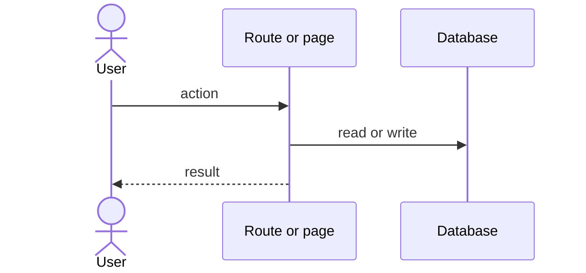

<!-- Copy this file to docs/changes/YYYY-MM-DD-<short-name>.md. Fill in every section.
     Short sentences, active voice, common words.
     scripts/workflow/check-explainer.sh checks: the paragraph, a Mermaid diagram, 3 questions, 3 answers. -->

# <Change name>

## What changed and why

<!-- One short paragraph, 3 to 5 sentences. Who this serves, what was broken or missing, what it does now.
     Put the same paragraph in the PR Summary. -->

## How it works

<!-- A Mermaid flow or sequence diagram of the new or changed path. -->

## Data model changes

<!-- A Mermaid ER diagram of the changed tables, or the word "None". -->

None

## Files changed

<!-- Group by purpose. One line per file. -->

| Purpose | File | Change |
|---|---|---|
| | | |

## How the owner can check it on staging

<!-- Numbered steps on https://staging.example.com: what to open, what to do, what you should see. -->

1. 
2. 
3. 

## Risks and rollback

<!-- What can break, and the exact steps to undo it (for example: revert the squash commit on staging). -->

## Check your understanding

1. <Question 1>
2. <Question 2>
3. <Question 3>

Answers

1. <Answer 1>
2. <Answer 2>
3. <Answer 3>

