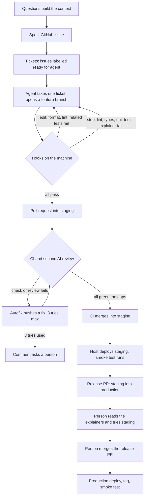

# From spec to production: the flow

This workflow lets agents do most of the building. A person still decides what to build and what to release. Every step leaves a written trace, so the person keeps up with the code.

## 1. Questions build the context

Work starts with questions, not code. The agent asks about the problem, the users, what to leave out and what is hard to undo. Each question comes with a recommended answer, so the person can reply "yes" and move on. The questions stop when nothing is left to assume.

## 2. The spec becomes a GitHub issue

The answers become a short spec. It says who the change serves, what it does not do, what it makes harder later and whether it is easy to reverse. The spec lives in a GitHub issue, where the review can find it later.

## 3. The spec splits into tickets

The agent splits the spec into ticket issues. Each ticket is small enough for one pull request. Each ticket gets the label "ready for agent". The person checks the order and the scope before any code exists.

## 4. Each ticket becomes a pull request

An agent takes one ticket and opens a feature branch. It writes a failing test first, then the smallest code that makes the test pass. It never pushes to staging or production.

## 5. Hooks check the work on the machine

Three hooks run in Claude Code:

- **guard.sh** runs before each shell command. It blocks force pushes, pushes to protected branches, branch deletes, `rm -r` outside the repo, merges, branch protection changes and secret reads. It reads the command word by word, so a new spelling does not get past it.
- **post-edit.sh** runs after each edit. It formats and lints the file, then runs the tests related to it. A failure goes straight back to the agent.
- **stop.sh** runs before the agent stops. It runs lint, types, unit tests and the explainer check. After 3 blocks it lets the agent stop and report what still fails.

## 6. The PR explains itself

Each PR has a summary paragraph: what changed and why. The same paragraph opens an explainer file in `docs/changes/`. The explainer also holds a diagram, the risks and three questions with answers. The questions test whether the reader understood the change.

## 7. CI and a second AI review check it

CI runs lint, types, unit tests, build and end-to-end tests. A second Claude reads the diff and the linked ticket. It reports only gaps that matter: wrong behaviour, security, missing tests, or code that does not match the ticket. A gap fails the job.

When a check or the review fails, an autofix job lets Claude push a fix. It tries 3 times at most. Then it posts a comment and waits for a person.

## 8. Green PRs merge to staging

When every job is green and the review found no gap, CI squash-merges the PR into staging. This step is optional: it runs only when the `AUTO_MERGE_ENABLED` variable is set. The host deploys staging. A read-only smoke test sends GET requests to a few paths and posts the result on the commit.

## 9. A person releases to production

A bot keeps one release PR from staging into production. Its body lists every merged change and the full text of each explainer. The person reads it, tries staging and checks the smoke test. Then the person approves and merges it with a merge commit. The agent cannot merge it: the guard hook blocks `gh pr merge`, and CI never merges into production.

After the merge, the host deploys production. A workflow tags the release and runs the smoke test again. The person keeps the two decisions that are hard to undo: what to build, and what to release.
